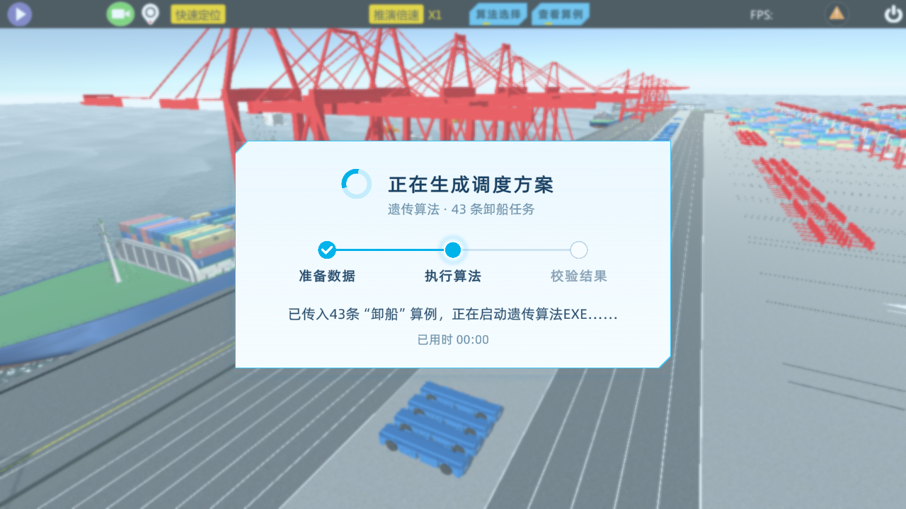

# 算法执行遮罩：真实场景可见性修复

## 结果

2026-10-19，在现有隔离验证工程中，以真实 `SceneStage1`、原有算法选择/原因/参数入口、43条本地卸船算例和一次本地遗传算法EXE完成回归。执行时显示已确定的浅蓝磨砂、切角面板、旋转环和三阶段遮罩；完成后关闭，进入调度结果核对页。主工程运行中的Unity未关闭、未切场景、未保存场景。

## 根因及修复

保存的非激活 `AlgorithmRunOverlay.prefab` 根节点缩放与尺寸均为0。原入口把它实例化为旧 `DecisionOverlayCanvas` 的子节点，变成非根Canvas，未恢复全屏尺寸，导致已激活但不可见。旧视觉测试把它移到根层级后才截图，没有覆盖生产挂载方式，因此不能证明真实场景入口正常。修复前数据见 `before-hierarchy.txt`。

1. `SceneDecisionWorkspaceController.cs`：遮罩不再挂到旧Canvas下，独立实例化；所属工作区销毁时清理遮罩。启动前检查遮罩有效，资源缺失或无效时提示并停止启动算法。
2. `AlgorithmRunOverlay.cs`：每次显示均校正根层级、缩放、全屏矩形和CanvasScaler；使用独立 `ScreenSpaceOverlay`、排序31000，不依赖场景相机或父CanvasGroup。时间与旋转继续使用不受暂停影响的时间。
3. 不改动遮罩预制体的颜色、布局或素材；保留准备数据/执行算法/校验结果的真实状态回调。继续只执行用户选择的一个算法，不增加固定等待，不自动跳回答题页。仍先显示一帧遮罩，再启动原算法入口。

## 验证

- 新增 `Assets/Editor/AlgorithmOverlayWorkflowVerification.cs`，仅允许隔离批处理执行。真实工作流 **36项PASS**，另有1条范围说明，见 `checks.txt`。包括旧父节点/零缩放回归、实际Game视图全屏边界、中央位置、最高层点击拦截、参数确认后显示、进程执行期间持续可见、43条结果、成功关闭、参数失败关闭/重试及销毁清理。
- 为缩短验证，GA使用合法参数：种群10、代数3，其余相关值依现有参数校验要求设置。这验证界面及调用链，不是算法优化质量或正式实验成绩验收。
- 原有界面回归 **67项PASS**，另有1条范围说明，见 `ui-regression-checks.txt`。覆盖答题、算法选择、参数确认、介绍页和暂停状态下的旋转/计时等。
- 故意使用非法种群参数测试失败分支时会出现预期的参数校验错误日志；未提交成绩或启动设备推演。服务器登录、任务下发和成绩上传不在本次验证范围。已有NuGet依赖缺失、场景缺脚本警告未在本次修改。
- `tested-source-sha256.csv` 记录主工程与隔离工程一致的测试源文件及预制体哈希。遮罩预制体与修复前备份哈希一致。

## 运行证据

`running-hierarchy.txt` 记录未转换渲染模式的生产态：独立根Canvas、ScreenSpaceOverlay、order31000、非零尺寸与缩放。全屏边界和点击拦截在真实Game视图中断言；Unity批处理Game视图为640×480。

以下1280×720图片是同一次真实流程的Unity渲染捕获。因 `Camera.Render` 不包含Overlay UI，截图瞬间临时将当前根Canvas交给港口相机绘制，随后立即还原；没有在截图后才建立生产态可见性，也不是重新生成的效果图。可见性断言在生产Overlay模式进行。

- `01-port-preparing.png`：确认参数后，原港口场景上出现准备遮罩。
- `02-port-exe-running.png`：真实遗传算法EXE已启动，三阶段处于执行算法。
- `03-port-result-review.png`：真实43条调度结果核对页，遮罩已关闭。
- `04-port-error-retry.png`：参数校验失败后，原参数界面恢复可操作。

## 使用与还原

在主工程先退出当前播放，等待脚本编译完成后重新播放，再按“算法选择→选择原因→确定参数”进入。不要用旧播放会话中已生成的对象判断新代码。

修复前备份：`Backups/AlgorithmOverlayVisibilityFix_20261018_232702/`，还原方法见其README。此前完整备份保留，本次没有更换界面方案、修改评分规则或算法实现。
