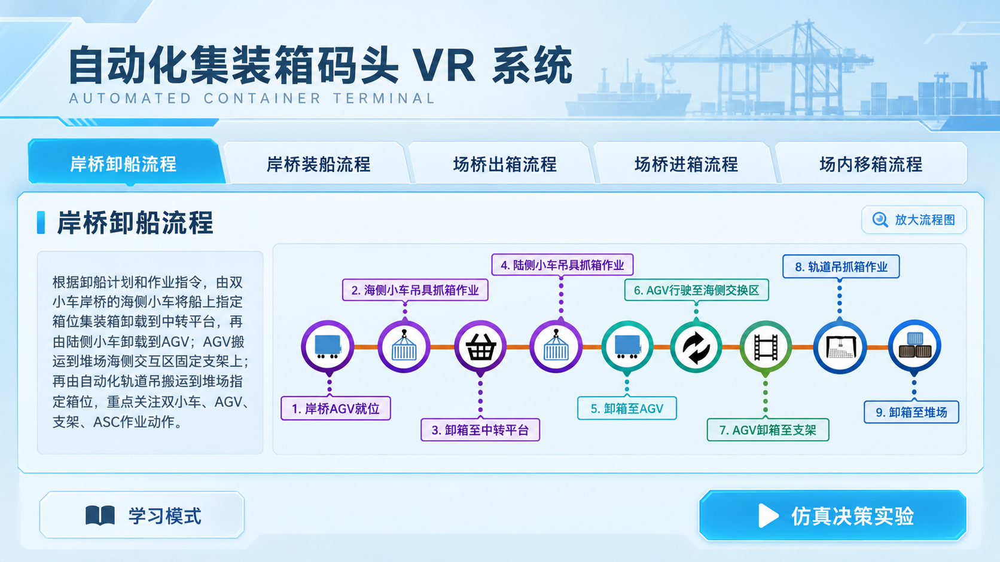
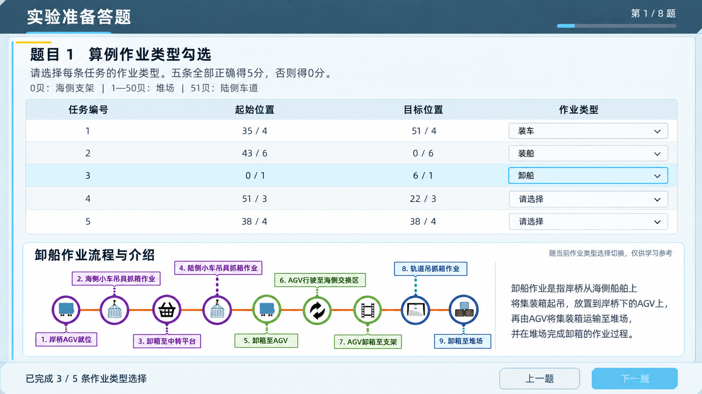
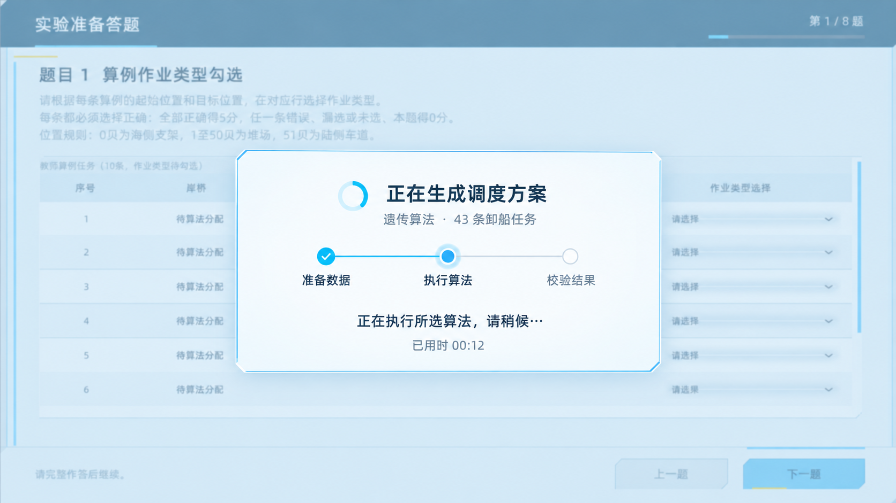

# 智慧港口 VR：界面与实验流程修改方案

日期：2026-10-18（Asia/Shanghai）

本轮交付为当前版本备份、只读代码检查、统一修改方案及四张提案图。尚未实施 Assets、Packages、ProjectSettings 中的界面、评分或算法逻辑变更。提案图不是 Unity 已实现截图，图片中的文字和布局以本文的实施规格为准。

## 备份与交付物

- 还原点：`Backups/UiFlowProposalRestorePoint_20261018_211507`。
- 快照：3,329 个文件，440,583,988 字节（约 420.17 MiB）。
- 已对每个快照文件与原文件执行 SHA-256 比较：不一致数量为 0。
- 包含 Assets 及 .meta、Packages、ProjectSettings、UserSettings、根目录文件和算法运行的 exchange/results。
- 缓存与历史备份没有重复复制，完整范围与还原方式见还原点内的 `还原说明.md`。
- 已保留用户本次四张原始截图，位于 `References/`。
- 四张生成预览均保存到 `Previews/`，未导入 Assets，也没有替换任何场景引用。

## 统一视觉方向

采用现有 `ExperimentUiTheme` 的浅色 Sci-Fi 控制台风格。登录页引入明亮、近未来自动化港口背景；实验介绍、答题、算法状态面板统一浅蓝灰底、白色内容面、深蓝标题和青蓝交互色。

| 用途 | 颜色 |
|---|---|
| 页面底色 | #E0EAF0 |
| 标题栏 | #305266 |
| 内容底色 | #EEF5F8 / #FFFFFF |
| 正文 | #23323D |
| 辅助文字 | #627684 |
| 主按钮 | #55B8E9 |
| 边线 | #AECADA |
| 选中底色 | #DBF2FC |

保留少量切角和细线作为 Sci-Fi 特征，降低强烈的模糊辉光。所有输入和下拉控件有明确边界，悬停、选中、禁用状态可区分。

以 1920×1080 为设计参考：标题约 40，说明约 30，表格与下拉约 30～32；对 1280×720 和约 1100 像素宽的窗口另外验收，避免缩放后重现小字问题。正文、表格和下拉文本不依赖自动缩小来塞入空间。

## 一、登录背景

预览：

使用本次生成的明亮近未来港口图：自动化岸桥、轨道吊、AGV、集装箱堆场和靠泊船舶，蓝灰主色、克制的青蓝科技细节，中部留出低细节区域供登录框使用。保留中央登录布局，登录面板按现有浅色主题处理，图片按比例铺满并裁切，不拉伸。

建议正式素材位置：`Assets/Art/UI/Login/SmartPortBackground.png`。登录场景仍使用 `SceneEntrance` 的既有账号、密码、登录与密码修改功能，保留 `AccountManager` 绑定和键盘操作。

当前生成图为 1672×941 的预览素材。实施时须按目标显示分辨率确认清晰度和裁切范围，不能把本次预览宣称为 4K 成品。

## 二、实验介绍页面

预览：

移除截图标出的圆形学校标识及其下方“国家级港口物流虚拟仿真中心”机构文字，重新排版主标题和英文副标题。移除的是本页面的显示对象及引用，先保留原图资源，避免其他页面共享时丢失引用。

页面采用浅色全屏控制台：顶部标题，下面五个流程标签，中间为说明与大流程图，底部保留“学习模式”和“仿真决策实验”。流程介绍文字复用现有内容，图像使用项目已有五张流程图，提供“放大流程图”以保证细小节点文字可读。

建议把原有流程内容整理为共用 `OperationFlowCatalog` 数据资源，一份内容同时供介绍页和第1题使用。流程图、标题、说明不在两个页面各维护一份。

| 作业类型 | 原介绍页流程 | 现有图像 |
|---|---|---|
| 卸船 | 岸桥卸船流程 | `Assets/UMenu Pro/Content/1.png` |
| 装船 | 岸桥装船流程 | `Assets/UMenu Pro/Content/2.png` |
| 装车 | 场桥出箱流程 | `Assets/UMenu Pro/Content/3.png` |
| 卸车 | 场桥进箱流程 | `Assets/UMenu Pro/Content/4.png` |
| 翻箱 | 场内移箱流程 | `Assets/UMenu Pro/Content/5.png` |

## 三、第1题：五类各一条、大字、下方流程介绍

预览：

“五题”按第1题内部的五条算例任务执行：整套准备答题仍为8题，第1题不再展示前10条。现有代码 `PreExperimentQuestionnaireController.Open` 调用 `CreateExampleSample(..., 10)`，且只按顺序取前若干条，无法保证五类全覆盖。

新的抽样规则：根据起点和终点判定类型，对教师完整算例分组，从卸船、装船、卸车、装车、翻箱五组各抽一条。一次作答内样本固定、返回上一题不重新抽取；展示顺序打乱，不能让固定行号变成答案提示。保存每条正式算例的 id、no、起终位置及学生选择，保持评分报告可追溯。

| 参考作业类型 | 起点区域 → 目标区域 |
|---|---|
| 卸船 | 0贝海侧支架 → 堆场 |
| 装船 | 堆场 → 0贝海侧支架 |
| 卸车 | 51贝陆侧车道 → 堆场 |
| 装车 | 堆场 → 51贝陆侧车道 |
| 翻箱 | 堆场 → 堆场 |

正式算例缺少任何一类时，提示教师任务缺少对应类型并允许重新获取；不把重复类型或编造任务算作完整五类。测试任务可以使用标记清楚的练习样本。

表格仅保留“任务编号、起始位置、目标位置、作业类型”。当前“岸桥”列多为“待算法分配”，与本题判定无关，删除该列可腾出宽度。五行优先完整展示，表格字和下拉菜单同时放大，行高约84设计单位、控件高度约60～64。下拉仍在点击控件附近展开，向下空间不足时向上展开，浮层置于滚动裁剪区域外。

任意一行选择作业类型后，自动展开表格下方的共用“流程与文字介绍”区域，展示学生当前所选类型的介绍。再次选择或切换行时更新该区域，未答状态可收起。介绍区使用原流程图和同一份说明，可放大查看。它提供学习参考，不显示该行是否正确或即时得分，也不自动改写学生答案。

第一题评分仍为：五条全部选择正确得5分；任意错选或未选得0分；总分保持100分。评分输入和 `ExpectedTaskTypes` 必须同步改为本次选中的五条，不能只改视觉行数。

## 四、卸船实验取消手工岸桥设置

目标流程改为：

`完成答题 → 进入三维预览 → 选择算法 → 选择原因 → 输入参数 → 执行所选算法 → 核对调度结果 → 启动推演`

从卸船入口移除“岸桥设置”按钮和手工勾选页面，取消 `_stsConfigurationConfirmed` 的前置门槛，以及“先完成岸桥设置”的状态文案。其他实验是否仍需原设置页要按各自入口决定，本轮不批量删除共用脚本和资源。

### 当前代码的实际限制

主算法适配器读取输出列 `RMG` 并写入 `ScheduledOperationDto.craneId`，表示场桥/轨道吊。卸船动画在 `UMP_LevelInfo.DischargeShipScript` 中按目标箱区使用固定岸桥映射：1010→A35、1011→A36、1012→A37、1013→A40；源箱还取自 `InfoSTS.BuildCode()` 的手工勾选结果。

因此，隐藏设置页并不能自动获得算法选择岸桥的能力。实施必须连同输入、输出和动画适配一起处理。

### 建议实施规格

1. 以算例任务和船舶实际源箱生成完整的待作业清单，不再由勾选数量决定实验任务量。
2. 向算法提供可用岸桥清单、可作业范围、船舶源箱及相关限制；已有场桥资源继续独立保留。
3. 调度输出分别保留 `quayCraneId`（岸桥）和 `craneId`/`yardCraneId`（场桥），并关联明确的源箱、任务编号和执行顺序。
4. 原岸桥动画直接消费自动分配结果，不使用固定箱区映射冒充算法选择，也不把 RMG1/RMG2 当作岸桥1010/1011。
5. 开始推演前统一检查：任务不遗漏不重复、岸桥存在且可达、源箱足够、目标箱位有效。失败时保留错误信息并返回算法页。

当前部署的主算法是本地 `RmgAlgorithmEngine.exe`。若它尚不能接收岸桥资源或返回岸桥编号，需要算法端扩展输入输出或提供可更新的算法源实现；这项工作不能仅靠 Unity 的按钮和皮肤修改完成。该依赖应在开始正式实施第4项时先验证。

## 五、算法执行遮罩

预览：

采用与答题页相同的浅色切角面板，宽约620～700设计单位，居中显示；全屏仅叠加低透明度的蓝灰遮罩，仍能看见三维港口。预览图以答题页演示配色，正式运行应覆盖三维场景。

显示“正在生成调度方案”、所选算法、实际任务数、旋转活动指示、已用时。阶段为“准备数据 → 执行算法 → 校验结果”，仅在收到相应真实状态时切换；当前算法没有可靠完成比例时，不显示百分比或假进度。

计算中阻止重复执行和误操作。成功后收起并打开调度核对页；失败或超时后关闭计算态，显示简明原因和重试入口，不能永久遮挡。取消操作只有在进程管理真正支持取消后才增加。

## Canvas 与组件实施方式

页面和遮罩优先制作成可在 Inspector 中编辑的 Canvas/Prefab。控制器负责数据绑定、样本行实例化和显隐，避免再次把静态布局散落在运行时创建代码里。

建议结构（均为未来实施项，本轮未创建这些资产）：

```text
SceneEntrance / 现有登录Canvas
  LoginBackground
  PortLoginPanel

ExperimentIntroductionCanvas
  Header
  FlowTabs
  OperationFlowView
  Footer

ExperimentAssessmentCanvas（沿用现有独立Canvas）
  QuestionnaireLayer
    FirstQuestionPage
      FiveCaseRows
      OperationFlowView
  AlgorithmAssessmentLayer
  ScheduleResultAssessmentLayer
  AlgorithmRunOverlayLayer
```

`OperationFlowView` 共用 Prefab，`OperationFlowCatalog` 共用数据。算法遮罩使用独立层并验证排序；下拉选项浮层保持高于其页面，避免重现菜单创建了却被遮住的问题。

## 主要实施位置

| 项目位置 | 拟修改内容 |
|---|---|
| `Assets/Scenes/SceneEntrance.unity` | 替换背景引用，登录外观衔接主题，保留 AccountManager 绑定 |
| 实验介绍所在场景及原流程对象 | 移除标识显示，整理介绍页布局和五个流程标签 |
| `Assets/Scripts/Integration/PreExperimentQuestionnaireController.cs` | 五类分组抽样、大字表格、类型选择事件、流程说明展开 |
| `Assets/Scripts/Integration/PreExperimentAssessmentRuntime.cs` | 核对五条样本与评分输入一致，保留全对才得5分 |
| `Assets/Scripts/Integration/ExperimentUiTheme.cs` | 复用颜色和字号规范，降低控件过强辉光 |
| `Assets/Resources/ExperimentAssessmentCanvas.prefab` 及其编辑期构建器 | 保存新增组件和绑定，兼顾现有Canvas版本升级 |
| `Assets/Scripts/Integration/SceneDecisionWorkspaceController.cs` | 移除卸船手工设置门槛，接入新运行遮罩和自动分配流程 |
| `Assets/Scripts/Integration/AlgorithmDischargePlan.cs` | 传递每条任务的自动岸桥分配和源箱关系 |
| `Assets/Scripts/LocalAlgorithmExe/RmgExeResultAdapter.cs`、`RmgExeModels.cs` | 区分岸桥和场桥字段，适配扩展后的算法输入输出 |
| `Assets/UMenu Pro/Content/Scripts/UMP_LevelInfo.cs` | 卸船动画消费算法岸桥结果，移除对手工勾选源箱的依赖 |
| 新的流程目录、共用流程视图和运行遮罩组件 | 为介绍页、第1题和运行态提供可复用内容 |

现有场景文件包含二进制序列化资产。实施时应通过 Unity 编辑器/API 或受控编辑器构建器修改并保存，不直接对场景二进制做文本替换。

## 实施顺序与验收

先完成登录和介绍页外观，再完成第1题的数据抽样与共用介绍视图，然后调整卸船自动分配及运行遮罩，最后检查完整流程。

验收应覆盖：

- 1920×1080、1280×720、约1100宽窗口下文字、表格、流程图和底部按钮可读且不重叠。
- 第1题恰好五条、五种类型各一条；返回上一题、修改答案、滚动和打开下拉均正常。
- 五条全对得5分，任意一条错误得0分；整套题仍8题、总分仍100分。
- 五种选择都能调用同一份介绍数据，选错不显示正确性提示，不自动替学生更正。
- 卸船实验能不经过岸桥设置进入算法选择，且只执行学生选择的一种算法。
- 多岸桥自动分配时任务、源箱和目标箱位关联正确；源箱不足、无可用岸桥时有明确失败状态。
- 遮罩使用真实阶段，成功、失败、超时和重试后都能正确收起，三维输入锁能恢复。
- 本地评分报告仍保存原始答案、各项得分、总分和算法结果关联；本轮设计不扩大服务器写入范围。

这些是未来实施时的验收要求，本轮没有宣称已在 Unity 中完成运行验收。

## 生成说明

四张图由内置图像生成工具生成，采用一个统一方向；实际提示词与参考图说明见 `生成提示词.md`。图像用于方案审核，所有组件应在 Unity 中按本文重新实现和绑定，不把整张效果图当作可点击页面贴入Canvas。
